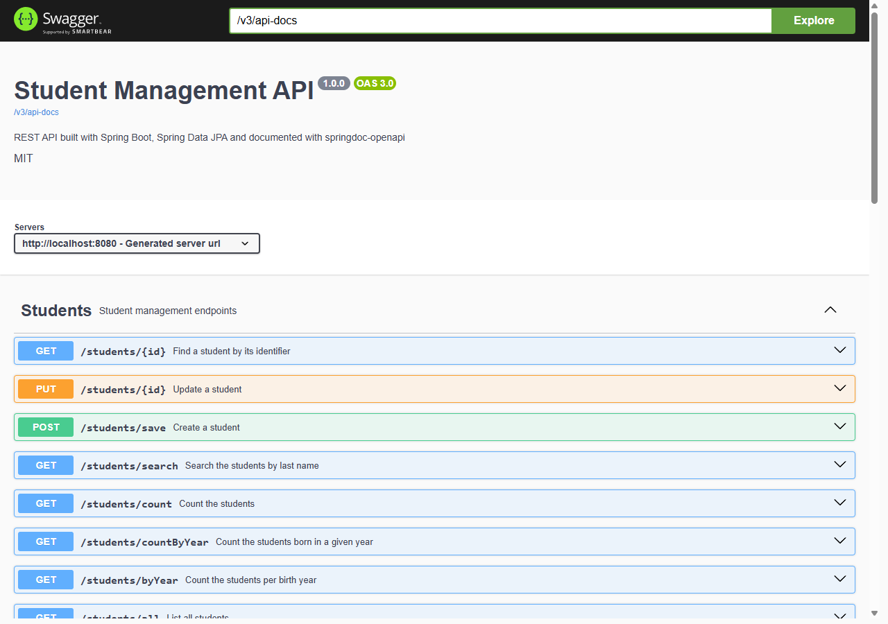

# J2E-TP6 — Spring Boot & Swagger

TP 6 du cours *Architecture Microservices* — API REST de gestion d'étudiants avec **Spring Boot 3**, **Spring Data JPA** et documentation **Swagger**.



## Stack

`Java 17` · `Spring Boot 3.2` · `Spring Data JPA` · `MySQL` · `JUnit 5 + Mockito` · `springdoc-openapi`

## Lancer

```bash
# Base (ou utiliser H2 pour les tests uniquement)
CREATE DATABASE studentdb;

mvn spring-boot:run   # http://localhost:8080
mvn test
```

- Swagger UI : <http://localhost:8080/swagger-ui.html>

## Endpoints

| Méthode | URL | Résultat |
|---|---|---|
| POST | `/students/save` | 201 |
| GET | `/students/all` | liste |
| GET | `/students/{id}` | 200 / 404 |
| PUT | `/students/{id}` | 200 / 404 |
| DELETE | `/students/delete/{id}` | 204 / 404 |
| GET | `/students/count` | total |
| GET | `/students/byYear` | répartition par année |

```bash
curl -X POST http://localhost:8080/students/save \
  -H "Content-Type: application/json" \
  -d '{"lastName":"LACHGAR","firstName":"Mohamed","birthDate":"1985-09-01"}'
```

## Architecture

```
controller/  StudentController   @RestController, annoté OpenAPI
service/     StudentService      @Service, @Transactional
repository/  StudentRepository   JpaRepository + @Query (group by année)
entity/      Student             @Entity → table students
config/      OpenApiConfig, CorsConfig, DataInitializer
```

**Tests : 12/12** — `StudentControllerTest` (8, Mockito), `StudentRepositoryTest` (4, H2).

Auteur : [zAK4-7](https://github.com/zAK4-7)
